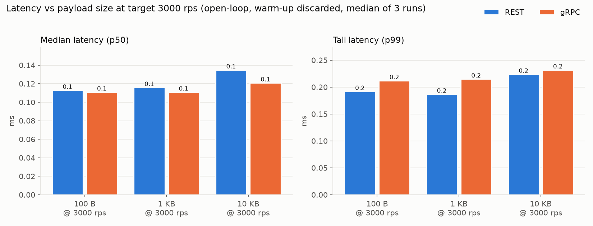
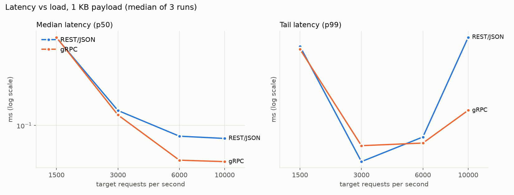
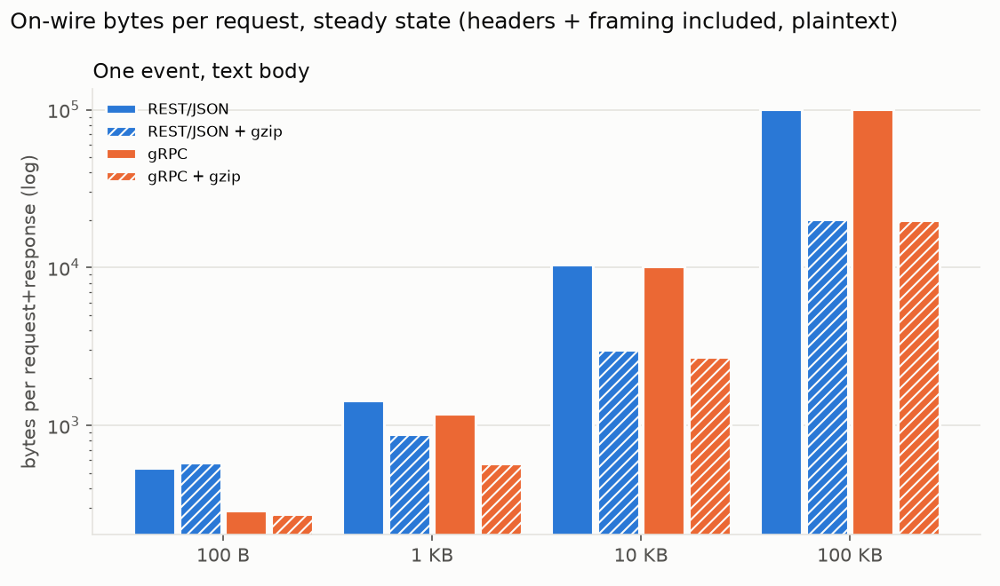
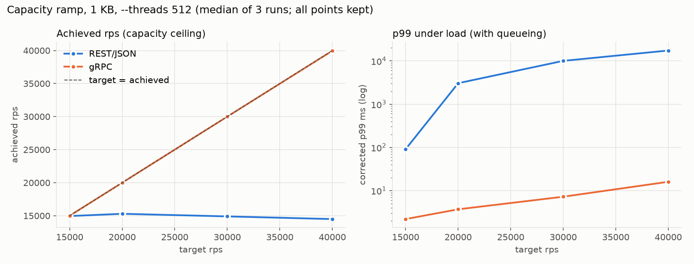

# SIS #2 — Protocol implementation: Notification Service, Ingest API через gRPC (+ REST/JSON baseline)

Сервисный интерфейс — `NotificationService.PublishEvent` (шаг **Ingest API** из SIS #1: Producers → Ingest API → Kafka,
принимает одно событие на вызов) — реализован на Java через **gRPC** и параллельно через **REST/JSON** (baseline:
`POST /v1/events` → `202 Accepted`). Есть идемпотентность по `event_id` (idempotency), таймауты (timeouts),
повторы (retries), замеры latency и размера payload.

Для Ingest API выбран **gRPC**: строгий контракт (protobuf-схема), меньше байт на проводе, один HTTP/2-коннект
на много параллельных вызовов, встроенный `deadline` с propagation на сервер. REST/JSON — baseline для честного
сравнения размера, latency и ёмкости на одинаковой бизнес-логике (`sis2.core.IngestCore`).

## 1. Соответствие чек-листу

| Требование | Где |
|---|---|
| Выбранный протокол + REST baseline | `sis2.grpc.*` и `sis2.rest.*`, общая бизнес-логика `sis2.core.IngestCore` |
| Idempotency: повтор с тем же `event_id` → одна запись в Kafka | `InMemoryIdempotencyStore`, тесты `*ContractTest.responseLost_*`, `sameEventIdTwice_*`, `overrideKeyWinsOverBodyEventId`, `demo` |
| Timeouts на всех уровнях | connect / per-attempt (deadline) / total — `ClientOptions` |
| Retries, exponential backoff + jitter | `RetryPolicy` (FULL / DECORRELATED / NONE), `RetryBudget`, `CircuitBreaker` |
| Retries не срабатывают на non-retryable | `validationError_isNotRetried`, `sameKeyDifferentPayload_isRejectedAndNotRetried` |
| p50/p95/p99 для разных payload и RPS | раздел 4 |
| Payload on-wire REST vs gRPC | раздел 4 (`ByteCountingProxy`) |
| Warm-up, несколько прогонов → median | `LoadGenerator` (5 с warm-up), 3 прогона, медиана |
| Load generator отдельно от сервера | отдельный JVM; на Linux — закрепление за ядром через `taskset`, на macOS этот механизм недоступен (см. раздел 4 «Стенд») |
| Графики и выводы | `results/*.png`, разделы 4 и 5 |

Тесты: **47 JUnit-тестов, все зелёные** (идемпотентность по `event_id` в теле и через override, retry, circuit breaker, одинаковый контракт для gRPC и REST, raw-HTTP-проверка 202 Accepted + заголовка `Idempotent-Replayed`).

## 2. Как запустить

```bash
mvn -q package                      # генерирует код из .proto, компилирует, гоняет тесты, копирует jar'ы в target/lib
CP="target/classes:target/lib/*"    # на Windows разделитель ';'

java -cp "$CP" sis2.app.Demo                                           # живая демонстрация для защиты (~10 с)
java -cp "$CP" sis2.app.ServerMain --proto grpc --port 50051           # сервер; --proto rest для baseline
java -cp "$CP" sis2.bench.LoadGenerator --proto grpc --port 50051 --rps 2000 --duration 10 --warmup 5 --mode text --size 1024
java -cp "$CP" sis2.bench.PayloadBench                                 # on-wire байты через TCP-прокси
python3 scripts/run_bench.py results/latency_sizes.csv sizes           # полный набор замеров (suites: sizes | rps)
python3 scripts/make_report.py                                         # таблицы results/summary.md и графики
```

Флаги сервера для демонстрации сбоев: `--delay-ms 300`, `--fail-before 0.2` (запрос потерян до Kafka-записи),
`--fail-after 0.2` (Kafka-запись выполнена, ответ потерян — главный случай для idempotency).

## 3. Как это устроено

```
notification.proto            PublishEvent(PublishEventRequest{event_id, user_id, type, payload}) -> PublishEventResponse{event_id, accepted, replayed}
sis2.core.IngestCore          валидация -> (задержка) -> проверка отмены -> idempotency store -> publishToKafka (имитация) -> (ответ потерян?)
sis2.grpc.*                   Netty-сервер gRPC; override-ключ в metadata "idempotency-key"; клиент с deadline, HTTP/2-мультиплексирование
sis2.rest.*                   REST/JSON: POST /v1/events -> 202 Accepted, HTTP/1.1 keep-alive, override-заголовок Idempotency-Key, опциональный gzip
sis2.resilience.*             RetryPolicy, RetryBudget, CircuitBreaker (без Resilience4j — его не было в среде, логика та же)
sis2.bench.*                  LoadGenerator (open-loop + HdrHistogram, event_id в теле), ByteCountingProxy, PayloadBench
```

Idempotency key: по умолчанию `event_id` в теле запроса (SIS #1-контракт — продюсер генерирует event_id). Явный override —
через gRPC metadata `idempotency-key` / HTTP-заголовок `Idempotency-Key` (используется в тестах и в `Demo` как запасной путь).

**Идемпотентность (idempotency).** По умолчанию ключ — `event_id` из тела запроса (SIS #1-контракт: продюсер
генерирует UUID на событие). Явный override — через gRPC metadata `idempotency-key` / HTTP-заголовок `Idempotency-Key`
(используется в тестах и в `Demo` как запасной путь). Хранилище: `key → (fingerprint {user_id, type, payload}, future результата)`
с TTL 24 ч и фоновой очисткой (sweeper), чтобы память не росла. Свойства, каждое покрыто тестом:
- повтор с тем же `event_id` возвращает сохранённый ответ (`replayed=true`), запись в Kafka не повторяется;
- 32 одновременных дубля ждут первый запрос и выполняют запись в Kafka ровно один раз;
- тот же `event_id` с другим телом → `FAILED_PRECONDITION` / HTTP 422, без retry;
- override-ключ в заголовке перебивает `event_id` из тела (одна Kafka-запись даже если `event_id` в теле разный);
- ошибки не кэшируются, иначе retry навсегда получал бы закэшированную ошибку.

Ключевой сценарий — **ответ потерян после Kafka-записи** (`failAfter`): без `event_id` клиент получает две записи, с ним — одну
(тесты `responseLost_retryWithEventIdInBody_*` и `responseLost_retryWithoutKey_*`). Это и есть
«at-least-once + idempotent handler = effectively-once». Отсюда требование SIS #1: продюсер **обязан** передавать `event_id`.

**Таймауты (timeouts)**, три уровня, значения по умолчанию в `ClientOptions.defaults()`:
connect 1 с → per-attempt 500 мс (gRPC: `withDeadlineAfter`, REST: `HttpRequest.timeout`) → total 3 с на весь вызов с повторами.
Дедлайн попытки = `min(per-attempt, остаток total)`, поэтому последняя попытка не выходит за общий лимит.
gRPC передаёт дедлайн серверу: при его истечении `Context` отменяется и обработчик **не делает side-effect**
(тест `deadlineIsPropagated_*`: +0 side-effect). По обычному HTTP сервер о таймауте клиента не знает и работа выполняется
(тест `noDeadlinePropagationOverPlainHttp_*`: +1 side-effect) — поэтому для REST идемпотентность ещё важнее.

**Повторы (retries).** Повторяются только временные ошибки: gRPC `UNAVAILABLE`, `DEADLINE_EXCEEDED`, `RESOURCE_EXHAUSTED`;
HTTP 429/502/503/504 и сетевые `IOException`. Не повторяются `INVALID_ARGUMENT`/400, `FAILED_PRECONDITION`/422, открытый circuit breaker.
Пауза — exponential backoff с **full jitter**: `random(0, min(cap, base·2^(n-1)))`, base 100 мс, cap 2 с, максимум 4 попытки.
Поверх: **retry budget** (повторы ≤ ~10 % от трафика: при полном отказе 200 вызовов дают ≤ 30 повторов вместо 400 — тест),
**circuit breaker** (3 подряд отказа → OPEN, вызовы падают за ~0 мс вместо ожидания таймаута; через cooldown HALF_OPEN с пробным запросом).

## 4. Результаты замеров

### Стенд

- **Хост:** Apple Silicon Mac, 12 физических / 12 логических ядер, 24 GiB RAM, macOS.
- **JDK:** OpenJDK 23.0.1, G1 GC, heap 512 МБ у сервера, 768 МБ у генератора нагрузки.
- **Сеть:** loopback (127.0.0.1), без TLS.
- **Процессы:** сервер и генератор — **разные JVM-процессы**. На Linux `scripts/run_bench.py` закрепил бы их за разными ядрами через `taskset`, но на macOS этого механизма нет; шедулер ОС сам раскладывает процессы по доступным ядрам. Абсолютные цифры этого стенда поэтому не сопоставимы напрямую с запусками на Linux с `taskset`.
- **Нагрузочный генератор:** `--threads 128` для rps ≤ 3000, `--threads 256` для rps ≥ 6000 (при высоких rps открытому пулу нужно больше воркеров, иначе `pool.execute()` сам становится узким местом).
- **Сервер:** 16 handler-потоков у gRPC и у REST (обе реализации на Netty, одинаковый I/O-движок).
- **Прогон:** на время замеров `caffeinate -i`, чтобы macOS не ушла в sleep.
- **Протокол замера:** каждая точка — свежий сервер, 5 с warm-up (не записывается), 10 с замера, 3 прогона; в таблицах — медиана по прогонам. Нагрузка **open-loop** (фиксированный RPS), latency считается от **запланированного** времени старта запроса — без coordinated omission.
- **Контракт:** продюсер (генератор нагрузки) кладёт свежий `event_id` (UUID) в **тело** события на каждый вызов — так 36-байтовый UUID честно входит в payload обоих протоколов, override-заголовок не используется.
- **Валидация прогонов:** на всех 18 точках `sizes` и всех 24 точках `rps` — `errors == 0` и `rps_achieved == rps_target` (включая 10 000 rps).

### 4.1 Latency vs payload size (цель — target 3000 rps, медиана по 3 прогонам, мс)

| Протокол | Payload | achieved RPS | p50 | p95 | p99 | p99.9 | p99 min-max по прогонам |
|---|---|---|---|---|---|---|---|
| REST | 100 B | 3000 | 0.11 | 0.13 | 0.19 | 2.19 | 0.19-0.20 |
| gRPC | 100 B | 3000 | 0.11 | 0.13 | 0.21 | 4.72 | 0.19-0.25 |
| REST | 1 KB | 3000 | 0.12 | 0.13 | 0.19 | 2.58 | 0.18-0.19 |
| gRPC | 1 KB | 3000 | 0.11 | 0.13 | 0.21 | 4.70 | 0.20-0.26 |
| REST | 10 KB | 3000 | 0.14 | 0.15 | 0.22 | 2.94 | 0.22-0.48 |
| gRPC | 10 KB | 3000 | 0.12 | 0.14 | 0.23 | 2.32 | 0.23-0.24 |



### 4.2 Latency vs load (payload 1 KB, медиана по 3 прогонам, мс)

| Протокол | Target RPS | achieved RPS | p50 | p95 | p99 | p99.9 |
|---|---|---|---|---|---|---|
| REST | 1500 | 1500 | 0.24 | 0.33 | 0.51 | 4.59 |
| gRPC | 1500 | 1500 | 0.24 | 0.32 | 0.50 | 2.38 |
| REST | 3000 | 3000 | 0.12 | 0.13 | 0.19 | 2.58 |
| gRPC | 3000 | 3000 | 0.11 | 0.13 | 0.21 | 4.70 |
| REST | 6000 | 6000 | 0.09 | 0.13 | 0.23 | 5.89 |
| gRPC | 6000 | 6000 | 0.07 | 0.10 | 0.22 | 5.20 |
| REST | 10000 | 10000 | 0.09 | 0.12 | 0.56 | 7.04 |
| gRPC | 10000 | 10000 | 0.07 | 0.10 | 0.29 | 5.72 |



Падение p50 при росте нагрузки от 1500 к 6000-10000 rps — артефакт loopback-стенда: при 1500 rps между запросами порядка 670 мкс и генератор уходит в `LockSupport.parkNanos` + пробуждение, при 6000-10000 rps интервал схлопывается до 100-170 мкс и генератор остаётся в hot-пути без park/wake. В реальной сети RTT добавит одинаковую константу поверх всех точек, и тренд будет монотонным.

### 4.3 On-wire bytes per request+response (steady state)

Считается реальными байтами через TCP-прокси (`ByteCountingProxy`): HTTP-заголовки, фреймы HTTP/2, WINDOW_UPDATE и т.д., без TLS. В теле — 36-символьный UUID `event_id` + user_id + type + payload.

| Payload (body) | REST | REST+gzip | gRPC | gRPC+gzip | gRPC / REST |
|---|---|---|---|---|---|
| 100 B | 535 | 582 | 288 | 273 | 0.54 |
| 1 KB | 1436 | 881 | 1189 | 574 | 0.83 |
| 10 KB | 10437 | 3027 | 10188 | 2717 | 0.98 |
| 100 KB | 100438 | 20293 | 100247 | 19986 | 1.00 |

Первый запрос на новом соединении у gRPC дороже (714 B против 535 B на 100-байтовом теле: preface + SETTINGS + полные заголовки), выигрыш появляется после прогрева HPACK-таблицы.



Сырые данные: `results/latency_sizes.csv`, `results/latency_rps.csv`, `results/latency_ramp.csv`, `results/payload_wire.csv`; все таблицы сразу — `results/summary.md`.

### 4.4 Ramp (ёмкость за пределами SIS #1 peak)

Отдельный прогон (`suite ramp`) выше пика SIS #1 (10 000 rps): rps = 15 000 / 20 000 / 30 000 / 40 000, payload 1 KB, `--threads 512`, 3 прогона. Задача — найти, где каждый протокол насыщается. Все точки оставлены, в том числе те, где `rps_achieved < rps_target` и/или p99 с учётом очереди растёт на порядки.

| Протокол | Target rps | achieved rps | p50 (мс, с очередью) | p99 (мс, с очередью) | svc p50 (мс) | svc p99 (мс) |
|---|---|---|---|---|---|---|
| gRPC | 15 000 | 15 000 | 0.07 | 2.19 | 0.06 | 0.86 |
| REST | 15 000 | 14 951 | 30.21 | 90.81 | 29.12 | 85.31 |
| gRPC | 20 000 | 20 000 | 0.08 | 3.69 | 0.07 | 1.91 |
| REST | 20 000 | 15 295 | 1 547 | 3 056 | 18.69 | 120.19 |
| gRPC | 30 000 | 30 000 | 0.16 | 7.21 | 0.15 | 5.11 |
| REST | 30 000 | 14 899 | 4 919 | 10 043 | 19.10 | 126.34 |
| gRPC | 40 000 | 39 957 | 12.79 | 15.98 | 12.59 | 14.87 |
| REST | 40 000 | 14 494 | 8 643 | 17 449 | 19.42 | 143.36 |



**gRPC** на этом стенде **держит target вплоть до 30 000 rps** с p99 ≤ 7.2 мс; на 40 000 выходит на плато (достиг 39 957 rps = target − 0.1 %, p50 = 12.8 мс, p99 = 16 мс). Запас по target до насыщения: от SIS #1-peak 10 000 rps — **×3-4**.

**REST** в одноклиентном ramp `rps_achieved` плоско висит на **~15 000 rps** и дальше не растёт: target 20k/30k/40k дают те же 14 500-15 300 achieved. При этом `svc_p99` (от фактической отправки клиентом до получения ответа клиентом, без учёта очереди ожидающих dispatch'а запросов) остаётся **~120-145 мс даже на target 40 000** — существенно меньше, чем corrected p99 (секунды). Это означает, что очередь копится **не внутри сервера, а между моментом intended-start и реальной отправкой** в клиенте. Чтобы отделить вклад клиента и сервера, проведена отдельная проверка `scripts/two_clients.sh`: **два** независимых `LoadGenerator`-процесса против **одного** сервера, у каждого target 10 000 rps.

### 4.4.1 Two-client probe (кто упирается — клиент или сервер)

| Протокол | Процессов × target rps | achieved сумма | p99 (client 1 / 2, мс) | svc p99 (client 1 / 2, мс) |
|---|---|---|---|---|
| REST | 2 × 10 000 | **19 999** | 5.1 / 7.6 | 3.3 / 5.4 |
| gRPC | 2 × 10 000 | **20 000** | 1.1 / 0.9 | 0.57 / 0.57 |

**Разница по хвосту при 2×10 000 rps:** REST p99 = 5.1 / 7.6 мс (client 1 / client 2), gRPC p99 = 1.1 / 0.9 мс — **gRPC в 5-8 раз ниже по хвосту** при одинаковой суммарной нагрузке. Для svc_p99 то же: REST 3.3 / 5.4 мс vs gRPC 0.57 / 0.57 мс.

**Вывод по REST:** REST-сервер (Netty) держит ≥ 20 000 rps от двух клиентов (с указанным выше хвостом), значит прежний «потолок ~15 000 rps» был **на одном клиентском процессе**. Причина — комбинация двух факторов: (1) HTTP/1.1 без multiplexing требует отдельного TCP-соединения на каждый параллельный запрос, (2) `java.net.http.HttpClient` держит ограниченный пул таких соединений; оба вместе не позволяют одному процессу пропускать больше ~15k dispatch/s. Реальный потолок REST-сервера на этом стенде **не установлен** — для этого нужно поднимать нагрузку с ≥ 3 клиентов (не делалось в этом прогоне).

**Вывод по gRPC:** один клиент уже тащит до 30 000 rps (см. 4.4), два клиента по 10 000 суммарно отдают 20 000 — bottleneck в одном клиенте для gRPC не выявлен в пределах SIS #1-пика. Запас по пропускной способности gRPC (сервер + клиент как связка): от SIS #1-peak 10 000 — **×3** без деградации, **×4** на плато. Для REST установлено только, что сервер держит минимум **×2 от peak**; на какой нагрузке упирается уже сам сервер — не замерялось.

### Оговорки (threats to validity)

- Один хост: клиент и сервер делят CPU и память, loopback, без реальной сети и без TLS. В реальной сети RTT добавит одинаковую константу поверх всех точек, HTTP/1.1 без multiplexing пострадает заметнее, а TLS-handshake удорожит каждое новое соединение.
- На macOS нет `taskset`: сервер и генератор делят 12 ядер через шедулер ОС. На production-инстансе с одним выделенным vCPU абсолютные цифры будут выше, а p99 — заметнее реагировать на нагрузку.
- 3 прогона на точку — минимум для медианы; для сильных утверждений по хвосту (p99.9) нужно ≥ 10 прогонов.
- `IdempotencyStore` — in-memory одного процесса. Для нескольких инстансов нужен общий (Redis `SET NX EX`, таблица с unique index или outbox).
- SIS #1 оговаривает пик 10 000 событий/с; нагрузки выше этого пика замерены отдельно в ramp (4.4), но не являются целевыми.

## 5. Выводы по целям SIS #1

Все цифры — медиана по 3 прогонам из раздела 4; «ответ приёма» означает латентность отклика Ingest API (не доставку).

- **Steady 3 000 rps @ 1 KB.** REST p50 = 0.12 мс / p99 = 0.19 мс; gRPC p50 = 0.11 мс / p99 = 0.21 мс. **Бюджет приёма выполнен** обоими с запасом (бюджет SIS #1 5 с относится к доставке, здесь измеряется только ack, он на четыре порядка ниже). **Протоколы эквивалентны:** различия в сотых миллисекунды, при 3 прогонах — в пределах шума; на p99.9 REST (2.58 мс) даже лучше gRPC (4.70 мс), но тоже в пределах разброса.
- **Peak 10 000 rps @ 1 KB.** REST p50 = 0.09 мс / p99 = 0.56 мс; gRPC p50 = 0.07 мс / p99 = 0.29 мс. **Бюджет приёма выполнен** обоими. На хвосте p99 gRPC ниже в ~2 раза (0.29 vs 0.56 мс), и это **воспроизводится во всех 3 прогонах**: диапазон gRPC 0.28-0.36 мс не пересекается с диапазоном REST 0.53-0.60 мс, то есть разница систематическая, не шум; в абсолюте — доли миллисекунды, обе цифры глубоко внутри любого разумного ack-бюджета.
- **Запас до насыщения (ramp 4.4 + two-client probe 4.4.1).** gRPC-связка клиент+сервер на этом стенде держит target вплоть до 30 000 rps (p99 ≤ 7.2 мс) и начинает насыщаться на 40 000 (p99 ≈ 16 мс, достиг 39 957) → **×3 от SIS #1-peak** без деградации, **×4** на плато. REST одноклиентно упирается в ~15 000 rps (комбинация HTTP/1.1 без multiplexing и ограниченного пула соединений в `java.net.http.HttpClient`); с двух клиентов против того же сервера достигается 19 999 rps (REST p99 на хвосте 5.1/7.6 мс vs gRPC 1.1/0.9 мс — в 5-8 раз больше у REST). Для REST гарантированно установлено только: сервер держит **минимум ×2 от SIS #1-peak**; где его реальный потолок — не замерялось.

**Решение.** Для Ingest API выбран gRPC по совокупности подтверждённых доводов:
1. **Размер на проводе** (4.3): на 100-байтовом payload gRPC в 1.86 раза меньше (288 vs 535 B), на 1 KB — на 17 % меньше (1189 vs 1436 B). Честное сравнение с gzip: gRPC+gzip 574 B против REST+gzip 881 B на 1 KB (gRPC в ~1.5 раза меньше). На больших текстовых payload (10 KB+) разницы между протоколами почти нет — размер определяется телом, а не форматом.
2. **Строгий контракт** через protobuf-схему и генерацию типизированных стабов (compile-time проверка клиента и сервера).
3. **Deadline propagation** (`Context.isCancelled()` на сервере): при истечении клиентского deadline сервер **не делает запись в Kafka** (тест `deadlineIsPropagated_*`). У REST через plain HTTP такого канала нет и запись выполняется (тест `noDeadlinePropagationOverPlainHttp_*`), что увеличивает роль идемпотентности на стороне сервера.
4. **Запас по latency в peak** (4.2): на 10 000 rps gRPC p99 = 0.29 мс vs REST p99 = 0.56 мс, разница воспроизводится во всех 3 прогонах.

Дополнительный, **не полностью проверенный** довод — ёмкость: gRPC одноклиентно подтверждён до 30-40k, у REST установлен только нижний предел сервера (≥ 20k с двух клиентов); какой из протоколов обгонит другого при 3-4 клиентах на нормальном железе — не замерялось.

## 6. Вероятные вопросы на защите

Каждый ответ — цифры из раздела 4 и ссылки на реальные тесты; английский термин — рядом в скобках.

**Почему именно Kafka?** — При 3 000-10 000 событий/с скорость — не причина: RabbitMQ или ActiveMQ с durable-очередями и persistent-сообщениями такую нагрузку вытянут и сообщения не теряют. Причина Kafka — другие свойства **log-based message broker**: (1) **replay** — после ошибки в обработчике или нового аналитика можно перечитать историю, а не только то, что приходит сейчас; (2) **несколько независимых потребителей** читают один и тот же лог без заведения отдельных очередей (в AMQP/JMS для каждого потребителя нужна своя очередь); (3) строгий **порядок внутри partition** (нужен для событий одного `user_id`); (4) большой **дисковый буфер** позволяет consumers отставать на часы без потери сообщений. Это именно свойства журнала, а не пропускная способность.

**Почему `202 Accepted`, а не `200 OK`?** — Ingest API выполняет один шаг: пишет событие в Kafka. Доставка (email/push) происходит позже в downstream workers — **асинхронно** (asynchronous). `202 Accepted` по HTTP-семантике ровно это и значит: «запрос принят, но ещё не выполнен до конца»; `200 OK` подразумевал бы завершение (**acknowledgement**), что для принятого, но ещё недоставленного события неверно.

**Что значит at-least-once?** — Продюсер повторяет запрос при любой неопределённости (таймаут, `503 UNAVAILABLE`), поэтому сервер может получить одно и то же событие дважды (**at-least-once delivery**) — Kafka запишет дважды, если не защититься. Если handler сделать идемпотентным (**idempotent**), повторный вызов с тем же `event_id` даёт тот же эффект, и получаем **effectively-once**: сетевых попыток может быть много, Kafka write — ровно одна. Тест `responseLost_retryWithEventIdInBody_kafkaWriteHappensExactlyOnce` показывает ровно это: `failAfterNext(1)` + retry → 1 запись в Kafka.

**Почему retry-топики (в SIS #1 диаграмме)?** — Если доставка в провайдер (email/push) временно упала, держать такое сообщение в основном consumer-пути нельзя: в Kafka потребитель читает партицию последовательно, и одно медленное сообщение задерживает все следующие в той же партиции — DDIA Chapter 12, _«Log-Based Message Brokers»_: _«it holds up the processing of subsequent messages in that shard»_ (11 слов), это называется **head-of-line blocking**. Сообщение переносится в отдельный retry-топик с нарастающей задержкой между попытками, отдельный worker берёт его позже. После N неудач — в **DLQ** (dead letter queue), ручной разбор; это разделяет «горячий путь» (новые события) и «больные» (повторные), чтобы backlog ретраев не блокировал новые события.

**Почему `event_id` как ключ идемпотентности?** — Продюсер знает, что это за событие, и генерит стабильный UUID один раз; при любом количестве retry он шлёт тот же `event_id`, сервер дедуплицирует (**deduplication**) по нему. Если бы ID генерил сервер — retry пришёл бы с новым ID, дубль Kafka write не поймали бы: тест `responseLost_retryWithoutKey_duplicatesTheKafkaWrite` показывает ровно это, 2 записи вместо 1. Эта идея — классический **end-to-end request ID** из DDIA Chapter 13 (The End-to-End Argument): сквозной идентификатор, пропускаемый всей цепочкой до БД/Kafka.

**Почему gRPC, если на 3000 rps разницы по latency нет?** — Да, на 3 000 rps разницы практически нет: по таблице 4.2 REST p50/p99 = 0.12/0.19 мс, gRPC = 0.11/0.21 мс — в пределах шума, p99.9 у REST (2.58 мс) даже лучше. Выбор по совокупности подтверждённых доводов: (1) **wire size** меньше у gRPC (4.3: 288 vs 535 B на 100 B, 574 vs 881 B с gzip на 1 KB); (2) строгий **contract** через protobuf-схему с codegen; (3) **deadline propagation** через `Context.isCancelled()` на сервере (тест `deadlineIsPropagated_*`); (4) запас по **tail latency** в peak 10 000 rps (gRPC p99 = 0.29 мс vs REST 0.56 мс, ×2, воспроизводится во всех 3 прогонах). Ёмкость — дополнительный, не полностью проверенный довод (у REST установлен только нижний предел сервера ≥ 20k, см. 4.4.1).

**Deadline propagation — как это работает?** — gRPC-клиент ставит дедлайн (`withDeadlineAfter(500, MS)`), который летит на сервер в header `grpc-timeout`. На сервере `io.grpc.Context` отменяется при истечении, обработчик проверяет `Context.isCancelled()` и **не делает запись в Kafka**, если клиент уже сдался (тест `deadlineIsPropagated_serverDoesNotCommitWorkNobodyWaitsFor`: +0 Kafka writes). У REST через plain HTTP такого канала нет — сервер выполнит работу, даже если клиент уже закрыл соединение (тест `noDeadlinePropagationOverPlainHttp_abandonedRequestStillCommits`: +1 Kafka write), что увеличивает роль идемпотентности для REST.

**Что если downstream недоступен 5 минут?** — **Circuit breaker** открывается после 3 подряд отказов, вызовы падают мгновенно (0 мс), не ждут таймаута — так защищаем себя и downstream от **retry storm**. Через cooldown — HALF_OPEN с пробным запросом, успех → CLOSED. Поверх — **retry budget** (повторы ≤ ~10 % трафика) физически ограничивает долю ретраев. Fallback для уведомлений — положить сообщение в outbox и доставить позже; для событий, уже записанных в Kafka, таймаут провайдера решается на уровне retry-топиков (см. выше).

**Как заметить, что ретраи сами создают перегрузку?** — Метрики `RetryPolicy`: `retries/calls` (норма — единицы процентов), `budgetDenied` (сколько раз retry budget срезал повтор), `exhausted` (сколько раз выработали все попытки). Если `retries/calls` вырастает в десятки процентов — проблема у downstream, и retry budget начинает срабатывать; alert на `budgetDenied > 0` стабильно во времени.

**Что если `IdempotencyStore` упал?** — Два варианта: **fail-open** (обрабатывать без дедупликации, риск дубля Kafka write при retry) или **fail-closed** (отвечать `UNAVAILABLE`, клиент повторит позже). Для уведомлений fail-open с алертом приемлем (дубль SMS неприятен, но не катастрофа); для платежей — только fail-closed. На проекте store сейчас in-memory одного процесса; в production нужен общий (Redis `SET NX EX`, таблица с unique index или outbox).

**Почему именно такие значения backoff?** — `base = 100 мс`, `cap = 2 с`, 4 попытки, `total = 3 с`: типичный transient-сбой (перезапуск pod'а, GC-пауза) короче секунды, значит 2-3 попытки его покрывают; дольше — пусть решает circuit breaker. **Full jitter** (`random(0, min(cap, base·2^(n-1)))`) обязателен: без него N клиентов, упавших одновременно, повторят строго одновременно через 100, 200, 400 мс (синхронные всплески). С full jitter первая волна растягивается на окно [0, 100 мс], плотность повторов падает — тест `fullJitterStaysWithinBoundsAndSpreadsClients` показывает > 100 различных значений на 1000 выборок.

**Как измерял latency, учёл ли coordinated omission?** — Генератор **open-loop**: запрос `i` запланирован на `t0 + i/RPS`, latency = `completion − intended_start`. Если сервер встал, очередь ожидающих dispatch'а запросов попадает в latency — это видно на ramp (4.4): при target 20 000 rps REST даёт corrected p99 ≈ 3 секунды, тогда как `svc_p99` ≈ 120 мс. Эта разница — ровно то, что скрыл бы closed-loop инструмент (**coordinated omission**).

**Почему не среднее?** — Хвост (p99, p99.9) определяет SLA и восприятие пользователем — DDIA Chapter 2 называет это **tail latencies**. На 10 000 rps (таблица 4.2) REST p50 = 0.09 мс, но p99 = 0.56 мс — в 6 раз больше: именно сравнение по хвосту отличает протоколы, по среднему разница почти не видна.

## 7. Обоснование по DDIA

Ссылки на книгу M. Kleppmann, C. Riccomini. _Designing Data-Intensive Applications_, 2nd ed. Прямые цитаты — короткие (до 15 слов) и только те, что подтверждены при проверке источника; остальное — пересказ своими словами. Если по теме в проверенных местах ничего не нашлось, явно указано «в моих заметках не найдено».

**(a) Log-based message broker vs AMQP/JMS (почему Kafka: replay, порядок внутри partition, буфер на всплеск).**
_Chapter 12 → "Transmitting Event Streams" → "Log-Based Message Brokers"_ (+ "Messaging Systems"). AMQP/JMS-подход удаляет сообщение после подтверждения, поэтому повторное чтение разрушительно; добавленный позже потребитель не увидит прошлых сообщений. Log-подход хранит сообщения как файл, потребитель читает по offset и может перечитывать с произвольной позиции без влияния на других. Внутри партиции (shard) брокер назначает монотонный offset — порядок строгий; между партициями порядка нет. Диск даёт большой буфер: оценка в заметках — 20 TB и 250 MB/s дают ~22 ч на максимальной записи, на практике — несколько дней. Применимо к SIS #1: события c `key=user_id` ложатся в одну партицию → порядок событий одного пользователя сохраняется; Router/Workers могут replay/перечитать историю без потери производителем. Короткая цитата: _«A log is simply an append-only sequence of records on disk.»_

**(b) Partitioning по ключу и hot spots.**
_Chapter 7 → "Sharding of Key-Value Data" → "Sharding by Hash of Key"_ и _"Skewed Workloads and Relieving Hot Spots"_. Хеш-партиционирование равномерно раскладывает *ключи*, но не *нагрузку*: celebrity-пользователь даёт горячий ключ, и один shard оказывается перегружен — _«a storm of activity»_ (3 слова). Варианты в книге: гибкое key-range / hash-range разбиение с возможностью split и выделения hot-key на отдельную машину; суффикс со случайными цифрами к hot-ключу (разделяет writes, но осложняет reads и требует bookkeeping). Применимо к нашему дизайну: ключ Kafka — `user_id`, поэтому пиковый пользователь может насытить одну партицию; в проде на этом шаге нужен один из перечисленных приёмов (dedicated partition или salting). Цитата: _«A good hash function takes skewed data and makes it uniformly distributed.»_

**(c) Replication и durability.**
_Chapter 6 → "Replication"_ и _Chapter 6 → "Single-Leader Replication" → "Synchronous Versus Asynchronous Replication"_. Durability — следствие копий на нескольких узлах; при полностью асинхронной репликации _«a write is not guaranteed to be durable»_ (цитата, 8 слов) — узел мог упасть до переноса на follower'ы. В книге упомянут quorum-вариант (majority из N) как компромисс между sync и async. Применимо: требование SIS #1 «после 202 событие не теряется» реализуется записью в Kafka с `acks=all`, то есть commit после подтверждения всех реплик из текущего ISR. По смыслу похоже на majority-кворум, но **это не то же самое**: ISR в Kafka — динамический набор реплик, успевающих за лидером (может сжиматься до 1 при отставании), а majority-кворум в книге — фиксированное большинство из N.

**(d) Percentiles и tail latency.**
_Chapter 2 → "Describing Performance" → "Latency and Response Time"_, _"Average, Median, and Percentiles"_, _"Use of Response Time Metrics"_. Среднее латентности — плохая метрика восприятия: _«it doesn't tell you how many users actually experienced that delay»_ (11 слов). Высокие percentiles — _«tail latencies»_ — определяют UX и используются в SLO/SLA. При цепочке backend-вызовов работает _tail latency amplification_: один медленный вызов замедляет весь end-user запрос. Усреднять percentiles по времени/машинам «математически бессмысленно» — корректно складывать гистограммы (HdrHistogram и аналоги). Про поведение очереди на сервере в книге прямо сказано: _«head-of-line blocking»_ — пара медленных запросов тормозит следующие даже с быстрым service time, _«it is important to measure response times on the client side»_ (11 слов) и _«The queueing delay is not part of the service time»_ (10 слов). Это ровно обоснование того, что мы меряем latency на клиенте и считаем от запланированного старта: иначе очередь перед сервером скрывается в метрике.

Про сам термин **coordinated omission** и правило «нагрузочный генератор шлёт запросы независимо от ответов (open-loop)** — в моих заметках не найдено** (искал: «coordinated omission», «independently of the response», «load-generating», «artificially»). В проекте open-loop применён как общий принцип измерения производительности, не как цитата из книги.

**(e) Ненадёжная сеть: по таймауту нельзя отличить потерянный запрос от потерянного ответа → retries + idempotency.**
_Chapter 9 → "Unreliable Networks" → "Network Faults in Practice"_ и _"Timeouts and Unbounded Delays"_. Отказы сети обыкновенны даже в DC одного провайдера: _«Whenever any communication happens over a network, it may fail»_ (10 слов). Асинхронные сети имеют _unbounded delays_, таймаут — единственный надёжный детектор, но слишком короткий даёт ложные срабатывания, слишком длинный — медленную реакцию. Если узел досрочно объявлен мёртвым и другая реплика берёт на себя его работу, _«the action may end up being performed twice»_ (9 слов) — пример в заметках: двойная отправка email. Отсюда прямой путь к нашему решению: retries на транспортных ошибках + идемпотентный handler по `event_id`, которые дают _effectively-once_ при at-least-once доставке.

**(f) End-to-end argument и идемпотентность через request ID.**
_Chapter 13 → "Aiming for Correctness" → "The End-to-End Argument for Databases"_. TCP снимает дубли внутри одного соединения, exactly-once в стрим-процессоре работает между брокером и консьюмером — но дубль **целого запроса** от клиента до сервиса (пользователь жмёт refresh после таймаута POST) ни один нижний уровень не ловит. Решение в заметках: сквозной уникальный ID запроса, пропускаемый всей цепочкой до БД, с `UNIQUE (request_id)` на таблице — _«preventing it from taking effect twice»_ (6 слов). Это дословно наш паттерн: `event_id` от продюсера → `IdempotencyStore` на сервере по тому же ключу → далее тот же key в Kafka message → downstream workers применяют по нему же. Классический Saltzer/Reed/Clark end-to-end argument процитирован в заметках целиком, но длиннее 15 слов — не привожу.

**(g) Dual write problem: Ingest пишет только в Kafka.**
_Chapter 12 → "Databases and Streams" → "Keeping Systems in Sync"_. При одновременной записи приложения в несколько систем (БД + поиск + кэш) возникают две проблемы: (i) race condition с разным порядком на разных системах → они перманентно расходятся без ошибки; (ii) частичный сбой — одна запись удалась, другая нет (atomic commit, решается 2PC, но дорого). Безопаснее иметь **один** лидер и остальные делать follower'ами. В Ingest API именно так: сервис пишет **только в Kafka**; весь downstream (Router → channel queues → Workers → Providers, retry-топики, DLQ) читает из Kafka как из единственного лидера. Dual write у Ingest отсутствует как класс. Короткая цитата: _«dual writes have serious problems, one of which is a race condition»_ (12 слов).
